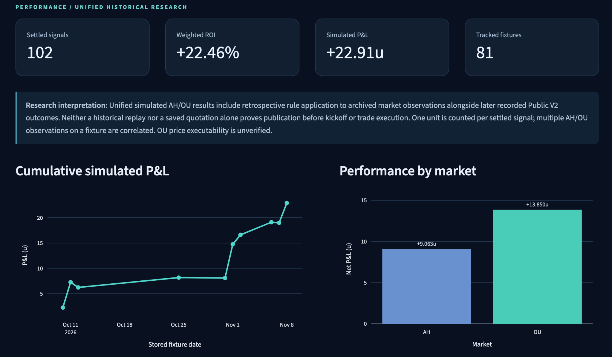
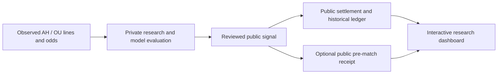

# Football Market Analytics

**Market-implied information · Asian Handicap & Asian Totals · Quantitative research**


A public, interactive research portfolio exploring what football betting markets reveal about future match outcomes — and how market signals can be evaluated, settled and audited.

[**Explore the live dashboard**](https://football-market-analytics.streamlit.app/) · [Browse the forecast ledger](https://football-market-analytics.streamlit.app/) · [Research methodology](docs/methodology.md) · [Public pre-match receipts](https://github.com/XiaodongYangQF/football-market-analytics-public/issues)

<!-- FMA_V41_VIDEO_START -->
## Research System in Motion

https://github.com/user-attachments/assets/d18b6d63-003a-49cc-b0a6-2577f115b9b8

**52-second research overview** · [Download MP4](assets/fma-research-in-motion-v4-1.mp4) · [Explore the interactive dashboard](https://football-market-analytics.streamlit.app/)

*Conceptual workflow visualization using curated historical research records and **simulated** performance. This is not verified live-trading or an independently timestamped prospective track record.*
<!-- FMA_V41_VIDEO_END -->



*The dashboard shows historical **simulated** performance, including retrospective rule application. It is not verified live-trading performance, and the displayed ROI does not establish an out-of-sample edge.*

## The idea: market prices contain information

Financial markets and sports markets both express expectations about uncertain future outcomes. Option prices can reveal information about future asset returns; similarly, football **Asian Handicap (AH)** and **Asian Total (OU)** lines and odds contain information about the market's views of goal differences and total goals.

Writing home and away goals as \(G_H,G_A\), the two key observables are goal difference \(D=G_H-G_A\) and total goals \(T=G_H+G_A\). AH and OU quotes therefore carry complementary, incomplete information about the eventual match score.

These parallels motivate the research, but sportsbook odds are not the same as option-implied risk-neutral densities: quotes may also reflect bookmaker margins, risk management, customer demand, and other market frictions. Individual AH or OU quotations do not uniquely identify the full score distribution.

The underlying private research already incorporates **market-implied parameter estimation**, **model-based distribution recovery**, and **quantitative pricing comparisons**, drawing on concepts from financial economics, probability theory, and statistical inference. Broader investigation of pricing distortions and out-of-sample probability calibration remains part of the research agenda.

The practical question is:

> Can structured information in AH/OU quotations improve football outcome evaluation, and can the resulting decisions be assessed transparently against observed match results?

## What you can explore today

| Feature | Public experience |
| --- | --- |
| **Performance overview** | Cumulative simulated P&L, stake-weighted ROI and AH/OU and league-level comparisons |
| **Forecast ledger** | Search, filter and inspect fixtures, selected lines, recorded directions and settlement outcomes |
| **Asian-line settlement** | Quarter-goal lines, pushes, half-wins and half-losses, independently checked using public arithmetic |
| **Methodology & limits** | The evaluation protocol, sample provenance, quote limitations and what can be reproduced |
| **Pre-match archive** | A separate place for future GitHub-timestamped, publicly published forecasts; it does not turn historical replays into prospective picks |
| **Interactive forecast** | Visible input workflow; **new model predictions are unavailable on the hosted public instance** |

Hosted interactive forecasts are not enabled; genuinely prospective public receipts are separate from the historical record.

The public app is intended for readers, data scientists, quantitative researchers and football-market enthusiasts. You can inspect the results without installing software or providing betting information.

## Current research snapshot

The initial curated historical research snapshot contains **81 tracked fixtures** and **102 settled AH/OU signals**, with **+22.9125 units simulated P&L** on **102 units of notional stake** (**+22.46% stake-weighted ROI**). This combines historical replay observations and a later recorded Public V2 cohort into one public-facing ledger, without counting an overlapping fixture-market twice.

**Read this number correctly:** the interpretation policy was applied retrospectively to part of the sample, and some of these observations informed rule development. Results are descriptive, not an independently validated prospective return, and some OU quotes have unverified executability. The internal sources remain separately preserved for review; the public dashboard presents a consistent combined history. [Detailed methodology](docs/methodology.md).

## How the research workflow fits together



**What is publicly reproducible:** the curated release format, Asian quarter-line settlement arithmetic, fixture-level history aggregation, simulated performance summaries and dashboard rendering.

**What remains private:** the underlying prediction engine and its decision rules. No private code, credentials, reference data or personal betting history are included in this repository. Hosted visitors cannot execute the private model. The public receipt mechanism is separately designed to record when a forecast was posted; a historical source date alone does not prove pre-kickoff publication.

### Try the public settlement engine

The published quarter-line arithmetic is independent of the private prediction model. For example, a 3-goal match can half-win an Over 2.75 position:

```python
from fma_portfolio.settlement import settle

settlement, pnl_u = settle("OU", "OVER", 2.75, 1.95, "2-1")
print(settlement, pnl_u)  # HALF_WIN 0.475
```

This calculation settles an illustrative saved quote; it does not forecast the match or attest that the price was executable.

## A connection to quantitative finance and statistics

The research perspective is broader than selecting a winning team:

- **Market-implied information:** AH and OU prices provide partial, potentially noisy signals about the distributions of goal difference and total goals.
- **Distributional inference:** Implemented private research uses market information for parameter estimation and model-based distribution recovery; the underlying model specifications and decision rules are not disclosed.
- **Statistical evaluation:** Recorded outcomes permit transparent settlement, performance attribution and comparisons by market and competition.
- **Economic value:** Forecasting quality and simulated payoff are different objects; a positive historical ROI does not, by itself, establish a stable predictive edge.
- **Research integrity:** Distinguishing retrospective analysis, actual public pre-match publication and executable quotes is fundamental to valid inference.

### Next research questions

1. **Distributional extensions:** How robust is market-implied inference across alternative model assumptions and information sets?
2. **Out-of-sample probability calibration:** How well do inferred probabilities match observed frequencies in genuinely prospective data?
3. **Market benchmarks:** How does an independent model compare with appropriately margin-adjusted bookmaker consensus and closing prices?
4. **Path + terminal information:** Does the time path of quotation changes add predictive value beyond the terminal snapshot?
5. **Cross-league structure:** Do similar handicap lines convey comparable relative-strength information at different team and league levels?

These questions concern extensions and additional empirical validation, not the absence of implemented private distributional inference. The hosted public app does not expose the proprietary prediction engine or provide live model inference.

## Run the public dashboard locally

Requires **Python 3.11**. This command starts the **public-safe, read-only research dashboard**, not the private prediction engine.

```bash
git clone https://github.com/XiaodongYangQF/football-market-analytics-public.git
cd football-market-analytics-public
python -m pip install -r requirements.txt
python -m streamlit run app.py
```

To run validation checks in a development environment:

```bash
python -m pip install -r requirements-dev.txt
python scripts/security_check.py
python scripts/check_public_english.py
python -m pytest -q
```

## Explore the code and documentation

| Area | Where to start |
| --- | --- |
| Settlement mathematics | [`fma_portfolio/settlement.py`](fma_portfolio/settlement.py) |
| Performance calculations | [`fma_portfolio/metrics.py`](fma_portfolio/metrics.py) |
| Unified historical records | [`fma_portfolio/unified_history.py`](fma_portfolio/unified_history.py) |
| Statistical evaluation protocol | [`docs/evaluation.md`](docs/evaluation.md) |
| Publication provenance and caveats | [`docs/methodology.md`](docs/methodology.md) |
| Public/private architecture | [`docs/architecture.md`](docs/architecture.md) |
| Owner-local deployment / operations | [`INSTALL.md`](INSTALL.md) · [`Maintainer reference`](docs/maintainer_reference.md) |

## Operational guides (for maintainers)

The reader-facing overview is intentionally concise. The existing detailed procedures are still available: [Public launch](P8_2D_PUBLIC_LAUNCH.md), [first pre-match receipt acceptance](P8_2E_FIRST_RECEIPT_ACCEPTANCE.md), and [Local Public receipt bridge](P8_2F_LOCAL_PUBLIC_RECEIPT_BRIDGE.md). These describe a workflow for **genuinely prospective** public evidence; they do not authenticate older saved predictions retroactively.

## Project status and responsible interpretation

**Public research dashboard: live.** **Historical settlement: available.** **Independent prospective performance validation: not yet established.** **Hosted scientific prediction: deliberately disabled.**

This project is for quantitative research and education; it is not a betting recommendation or a claim of verified real-money returns. Market quotes may be non-executable, and retrospective decisions do not constitute independently timestamped pre-match forecasts. Reuse of the public source and data is subject to their respective rights; no license grant should be inferred solely from the visibility of this repository.

Created and maintained as an independent research portfolio. [Personal website](https://xiaodongyangqf.github.io/) · [Live dashboard](https://football-market-analytics.streamlit.app/).
